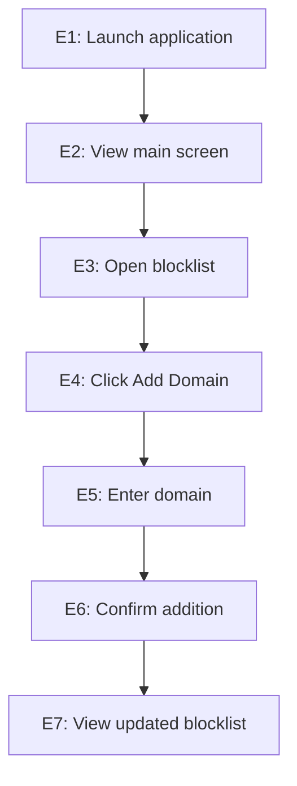

## SOEN 345 – Progress Report
Student Name: James Bautista

Student ID: 40272010

## Selected Application

**Application:** BlockAds (Android)

**Selected method for Question 1:**

```kotlin
fun formatBlockRule(domain: String, useAdblockFormat: Boolean = true): String {
    return if (useAdblockFormat) {
        "||${domain.lowercase()}^"
    } else {
        domain.lowercase()
    }
}
```

---

# Question 1 – Input Domain Modeling

## 1(a) Identify the parameters

The method has two parameters:

| Parameter | Type | Default value | Description |
|---|---|---|---|
| `domain` | `String` | None | The domain to format. |
| `useAdblockFormat` | `Boolean` | `true` | Determines whether to format the domain using Adblock syntax. |

Both are parameters declared in the method signature. Neither is a global variable.

## 1(b) Interface-based Input Domain Modeling

Interface-based input domain modeling considers the method's input interface, including the types and possible values of its parameters.

### Characteristic 1: `domain`

| Partition | Description | Example |
|---|---|---|
| P1 | Empty string | `""` |
| P2 | Non-empty string | `"example.com"` |

These partitions are complete and disjoint for Kotlin's `String` type.

### Characteristic 2: `useAdblockFormat`

| Partition | Description | Example |
|---|---|---|
| P1 | Adblock formatting enabled | `true` |
| P2 | Adblock formatting disabled | `false` |

These partitions are complete and disjoint for the Boolean parameter.

### Each Choice Coverage test inputs

Each Choice Coverage requires every partition of each characteristic to appear in at least one test. The following four tests cover all combinations of the two characteristics.

| Test | `domain` | `useAdblockFormat` |
|---|---|---|
| TC1 | `""` | `true` |
| TC2 | `""` | `false` |
| TC3 | `"example.com"` | `true` |
| TC4 | `"example.com"` | `false` |

### JUnit tests

```kotlin
import org.junit.Assert.assertEquals
import org.junit.Test

class FormatBlockRuleInterfaceTest {

    @Test
    fun emptyDomainWithAdblockFormat() {
        assertEquals("||^", formatBlockRule("", true))
    }

    @Test
    fun emptyDomainWithoutAdblockFormat() {
        assertEquals("", formatBlockRule("", false))
    }

    @Test
    fun nonEmptyDomainWithAdblockFormat() {
        assertEquals("||example.com^", formatBlockRule("example.com", true))
    }

    @Test
    fun nonEmptyDomainWithoutAdblockFormat() {
        assertEquals("example.com", formatBlockRule("example.com", false))
    }
}
```

## 1(c) Functionality-based Input Domain Modeling

Functionality-based input domain modeling considers characteristics that affect the method's behavior.

### Characteristic 1: Domain capitalization

| Partition | Description | Example |
|---|---|---|
| P1 | Contains no uppercase letters | `"example.com"` |
| P2 | Contains at least one uppercase letter | `"Example.COM"` |

These partitions are complete and disjoint: every string either contains an uppercase letter or does not. The first partition includes empty strings and strings containing only digits or symbols.

### Characteristic 2: Formatting option

| Partition | Description | Example |
|---|---|---|
| P1 | Adblock formatting enabled | `true` |
| P2 | Adblock formatting disabled | `false` |

### Each Choice Coverage test inputs

| Test | `domain` | `useAdblockFormat` |
|---|---|---|
| TC1 | `"example.com"` | `true` |
| TC2 | `"example.com"` | `false` |
| TC3 | `"Example.COM"` | `true` |
| TC4 | `"Example.COM"` | `false` |

These four tests cover every partition of both characteristics.

### JUnit tests

```kotlin
import org.junit.Assert.assertEquals
import org.junit.Test

class FormatBlockRuleFunctionalityTest {

    @Test
    fun lowercaseDomainWithAdblockFormat() {
        assertEquals("||example.com^", formatBlockRule("example.com", true))
    }

    @Test
    fun lowercaseDomainWithoutAdblockFormat() {
        assertEquals("example.com", formatBlockRule("example.com", false))
    }

    @Test
    fun uppercaseDomainWithAdblockFormat() {
        assertEquals("||example.com^", formatBlockRule("Example.COM", true))
    }

    @Test
    fun uppercaseDomainWithoutAdblockFormat() {
        assertEquals("example.com", formatBlockRule("Example.COM", false))
    }
}
```

### Difference between interface-based and functionality-based modeling

- **Interface-based modeling** considers the input interface, such as empty versus non-empty strings and the two possible Boolean values.
- **Functionality-based modeling** considers behavioral characteristics, such as whether the domain contains uppercase letters and whether Adblock formatting is enabled.

---

# Question 2 – GUI-level Each Choice Coverage

| Test | GUI actions | Expected behavior |
|---|---|---|
| TC1 | Open blocklist → Enter an empty domain → Enable Adblock formatting → Click Add | Empty input is rejected or handled according to the application's validation rules. |
| TC2 | Open blocklist → Enter an empty domain → Disable Adblock formatting → Click Add | Empty input is rejected or handled according to the application's validation rules. |
| TC3 | Open blocklist → Enter `example.com` → Enable Adblock formatting → Click Add | The generated rule is `||example.com^`. |
| TC4 | Open blocklist → Enter `example.com` → Disable Adblock formatting → Click Add | The generated rule is `example.com`. |

---

# Question 3 – Event-Flow Graph

## 3(a) Event-Flow Graph

The following is a proposed simplified flow for adding a domain in BlockAds:



**Important:** This is a proposed graph. Update the nodes and edges to match the actual screens and interactions in the installed version of BlockAds.

## 3(b) Two UI test cases based on the EFG

### Test Case 1: Add a domain

| Step | User interaction |
|---|---|
| 1 | Launch BlockAds. |
| 2 | View the main screen. |
| 3 | Open the blocklist. |
| 4 | Click Add Domain. |
| 5 | Enter `example.com`. |
| 6 | Confirm the addition. |
| 7 | View the updated blocklist. |

**Expected behavior:** The domain is successfully added and appears in the blocklist.

### Test Case 2: Remove a domain

| Step | User interaction |
|---|---|
| 1 | Launch BlockAds. |
| 2 | View the main screen. |
| 3 | Open the blocklist. |
| 4 | Select an existing domain. |
| 5 | Click Remove. |
| 6 | Confirm removal if prompted. |
| 7 | View the updated blocklist. |

**Expected behavior:** The selected domain is removed from the blocklist.


---

# Question 4 – Logic Coverage

## 4(a) Selected method

The selected method from the BlockAds application is `addToCustomBlockRules()`:

```kotlin
fun addToCustomBlockRules(domain: String) {
    viewModelScope.launch {
        val cleanDomain = domain.trim().lowercase()
        val ruleText = CustomRuleParser.formatBlockRule(cleanDomain)
        val rule = CustomRuleParser.parseRule(ruleText)
        if (rule != null) {
            if (customDnsRuleDao.exists(rule.rule) == 0) {
                customDnsRuleDao.insert(rule)
                filterRepo.loadCustomRules()
            }
            _events.toast(R.string.rule_added)
        }
    }
}
```

This method contains two conditional predicates:

1. **Predicate P1:** `rule != null`
   - `true`: The formatted domain is successfully parsed into a rule.
   - `false`: Parsing does not produce a valid rule (`rule` is `null`).

2. **Predicate P2:** `customDnsRuleDao.exists(rule.rule) == 0`
   - `true`: The rule does not already exist in the database.
   - `false`: The rule already exists in the database.

P2 is nested inside P1, so it is evaluated only when P1 is true.


## 4(b) GUI test cases for Predicate Coverage

Predicate Coverage requires each predicate to evaluate to both `true` and `false`.

Because P2 is only reached when P1 is true, three executions are needed to cover both outcomes of both predicates. The assignment asks for two test cases; the following explains why two are insufficient for full predicate coverage of both nested predicates.

### Test Case 1 – Invalid rule (P1 evaluates to FALSE)

| Step | User interaction |
|---|---|
| 1 | Launch BlockAds. |
| 2 | Navigate to the custom block rules screen. |
| 3 | Open the Add Custom Rule interface. |
| 4 | Enter an invalid domain or rule that `CustomRuleParser.parseRule()` rejects. |
| 5 | Submit the rule. |

**Expected behavior:**
- `rule` is `null`.
- P1 (`rule != null`) evaluates to `false`.
- The database existence check is not executed.
- No rule is inserted.

Predicate evaluation:

```text
P1 = false
P2 = not evaluated
```

### Test Case 2 – Valid, new rule (P1 and P2 evaluate to TRUE)

| Step | User interaction |
|---|---|
| 1 | Launch BlockAds. |
| 2 | Navigate to the custom block rules screen. |
| 3 | Open the Add Custom Rule interface. |
| 4 | Enter a valid domain that is not already in the custom rules database, such as `example.com`. |
| 5 | Submit the rule. |

**Expected behavior:**
- The rule is parsed successfully.
- P1 (`rule != null`) evaluates to `true`.
- The database reports that the rule does not exist.
- P2 (`exists(rule.rule) == 0`) evaluates to `true`.
- The rule is inserted and the custom rules are reloaded.
- A success toast is displayed.

Predicate evaluation:

```text
P1 = true
P2 = true
```

### Additional execution needed – Existing rule (P2 evaluates to FALSE)

To complete Predicate Coverage, execute one more test:

| Step | User interaction |
|---|---|
| 1 | Ensure `example.com` already exists in the custom block rules database. |
| 2 | Open the Add Custom Rule interface. |
| 3 | Enter `example.com` again. |
| 4 | Submit the rule. |

**Expected behavior:**
- The rule is parsed successfully.
- P1 (`rule != null`) evaluates to `true`.
- The database reports that the rule already exists.
- P2 (`exists(rule.rule) == 0`) evaluates to `false`.
- No duplicate rule is inserted.

Predicate evaluation:

```text
P1 = true
P2 = false
```
---
